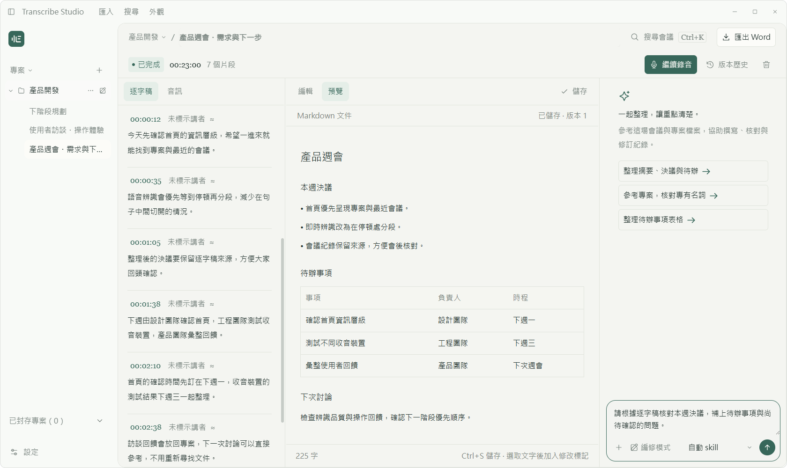
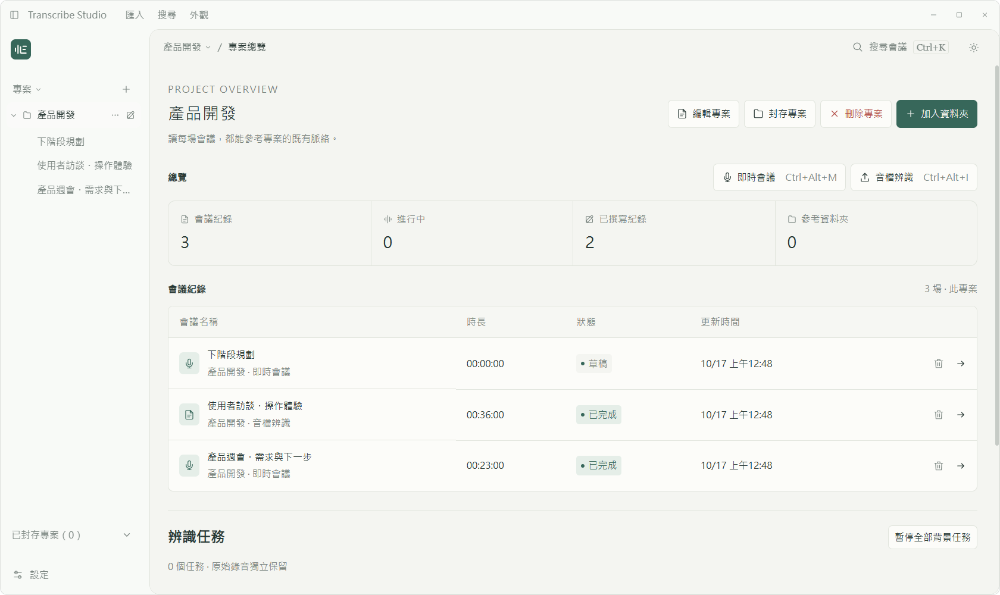
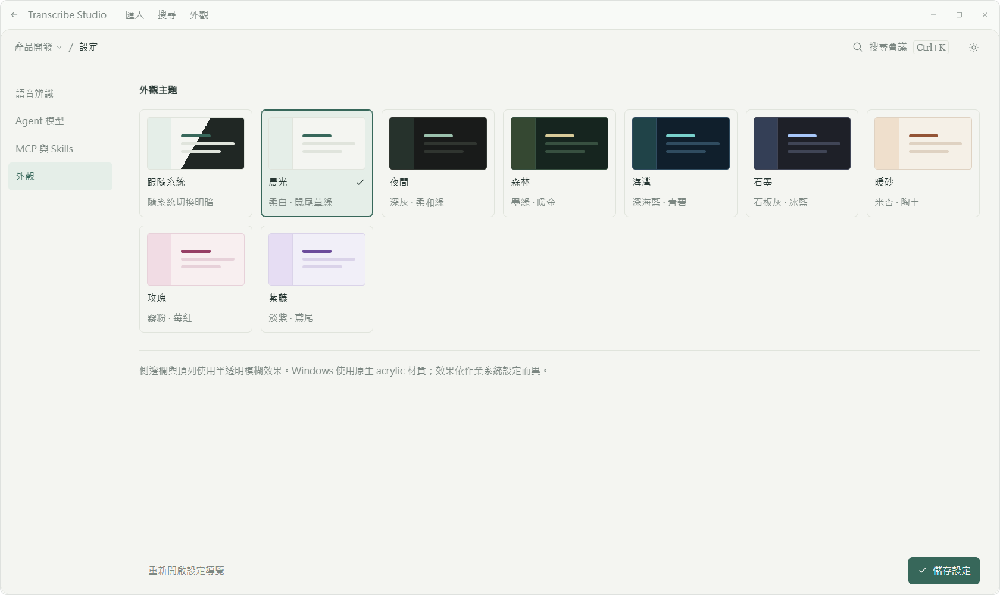

# Transcribe Studio

從錄音、逐字稿到會議紀錄，讓每場討論留在專案脈絡裡。

[簡介](#1-簡介) · [安裝方式](#2-安裝方式) · [功能](#3-功能) · [LICENSE](#4-license)

## 1. 簡介

Transcribe Studio 是以專案為中心的桌面會議記錄助手，使用 TypeScript、Electron 與 React 開發。你可以錄製麥克風與電腦音訊、匯入錄音，將逐字稿交給 Agent 整理，並在確認提案後更新會議紀錄。

會議資料保存在本機；語音辨識與 Agent 依你設定的服務執行，也可接入相容的自架服務。



> 截圖使用獨立示範資料，展示 Windows 桌面介面。

| 平台    | 支援範圍                                                              |
| ------- | --------------------------------------------------------------------- |
| Windows | x64 安裝版；可擷取指定播放裝置與麥克風                                |
| macOS   | Apple Silicon（arm64），macOS 13 以上；原生系統音訊需 macOS 14.2 以上 |

macOS 的實際權限、音訊裝置與正式簽章仍需實機驗收。辨識品質取決於錄音與所選模型。

## 2. 安裝方式

### 使用安裝檔

前往 [GitHub Releases](https://github.com/aitay721822/transcribe-studio/releases)，若該版本已發布，依平台下載對應檔案。

| 平台        | 檔案                                 | 使用方式                             |
| ----------- | ------------------------------------ | ------------------------------------ |
| Windows x64 | `Transcribe Studio Setup <版本>.exe` | 執行安裝程式，可選安裝位置並建立捷徑 |
| macOS arm64 | `.dmg`                               | 開啟 DMG 將應用程式拖入 Applications |

一般本機建置未簽章／公證；正式 Mac 發布可透過簽章與公證流程產生套件。Windows 解除安裝會保留會議資料與設定。

### 從原始碼啟動

建議使用 Node.js 24 與 npm。

```sh
git clone https://github.com/aitay721822/transcribe-studio.git
cd transcribe-studio
npm ci --include=optional
npx --no-install install-electron
npm start
```

`npm start` 會先檢查並編譯程式，再啟動 Electron。

預設建置會壓縮 JavaScript 並使用 React 正式版，不內嵌 source map；需要除錯時，可設定環境變數 `STUDIO_DEBUG_BUILD=1` 再建置。安裝檔只攜帶執行時相依套件與英文／繁體中文 Electron 語系，保留 FFmpeg，不隨附 Claude Code 執行檔。

### 第一次設定

首次啟動會開啟設定導覽，完成以下設定後即可進入工作區：

1. 設定**離線語音辨識**的完整 HTTP 端點與模型；服務需要驗證時填入 API key。
2. 選擇 **Agent 後端**：OpenAI API、Codex 或 Claude Code；依模式設定 API 或本機 CLI。
3. 使用連線測試確認服務，再建立專案與會議。即時串流辨識為選用功能。

「離線辨識」指上傳音檔或音訊分段的轉錄模式；是否能完全離線，取決於你是否使用本機服務。外部 API 可能需要網路並產生服務費用。

選用 Claude 時，請先依 [Claude Code 官方說明](https://code.claude.com/docs/en/setup)安裝 CLI。API 與 CLI 登入模式皆需要本機執行檔；安裝後重新偵測，或在設定中指定路徑。CLI 登入模式另需執行 `claude auth login`。使用 OpenAI API 不需要安裝 Claude。

### 自行打包

```sh
# Windows x64 安裝版
npm run package

# Apple Silicon Mac：須在 Mac 上執行
npm run package:mac
```

產物位於 `release/`，僅提供 Windows 安裝程式與 Mac arm64 DMG。Mac 封裝時會檢查 FFmpeg 的架構。正式 Mac 簽章、公證與 CI 設定見[使用與開發參考](docs/reference.md#macos-建置與驗收)。

### 使用 tag 發布版本

版本 tag 須與 `package.json` 一致，例如目前版本為 `0.4.3`：

```sh
git tag -a v0.4.3 -m "Release 0.4.3"
git push origin v0.4.3
```

推送 `v0.4.3` 或 `0.4.3` 形式的 tag 後，GitHub Actions 會驗證版本、執行測試並建置 Windows 安裝程式與 Mac arm64 DMG。兩個平台皆成功後，才會在 [Releases](https://github.com/aitay721822/transcribe-studio/releases) 建立版本頁、上傳兩個安裝檔與 `SHA256SUMS.txt`，並產生版本說明。帶有 `-beta.1` 等後綴的版本會標示為預先發布。

Tag 發布預設不使用 Mac 簽章憑證；有正式簽章需求時，使用手動 workflow 的 `signed_release` 流程。分支與 PR 驗證不會建立 Release。

### 開發檢查

| 指令                       | 用途                       |
| -------------------------- | -------------------------- |
| `npm run format`           | 整理格式、匯入與宣告間距   |
| `npm run check`            | 檢查格式、型別與來源結構   |
| `npm run lint`             | 執行 Biome lint 與間距檢查 |
| `npm test`                 | 建置後執行自動測試         |
| `npm run test:ui`          | 執行 Electron 完整介面測試 |
| `npm run test:ui:platform` | 驗證平台介面與系統憑證加密 |
| `npm run test:packaged`    | 驗證已封裝應用程式         |

專案使用 `.gitattributes` 統一 LF 換行。既有 Windows 工作目錄若出現 Biome 換行錯誤，先執行 `npm run format`，再執行 `npm run check`。

## 3. 功能

### 專案與會議管理

- 專案總覽整合會議數、已撰寫紀錄、參考資料夾數與辨識任務。
- 支援釘選、分組、封存、搜尋與刪除確認。
- 每個專案可引用多個本機資料夾；移除引用不會刪除來源檔案。
- Agent 可搜尋同專案的先前會議，將歷史背景與本次決議分開整理。



### 錄音與語音辨識

- 麥克風、電腦音訊可獨立選擇，也可混音；開始前可測試音量與辨識連線。
- HTTP 收音優先在說話後安靜約 **0.9 秒**時分段；連續說話達設定的 **2／5／10／15 秒上限**時送出。
- 可接入 OpenAI 或 vLLM Realtime 串流服務；也可只錄音，會後再辨識。
- 支援 WAV、MP3、M4A、FLAC、WEBM、OGG 等音檔，單檔上限 **1 GB**；TXT／SRT／VTT 逐字稿上限 **25 MB**。
- 匯入音檔提供解碼、背景降噪與停頓分段；原始檔案保留。
- 辨識任務保存在本機，可查看進度、暫停、重試與補辨識；會後可選範圍替換逐字稿。
- 錄音播放器提供定位、拖曳進度、音量、靜音與倍速。

目前未提供手動講者標註或即時講者分離。服務若回傳講者資訊，可顯示在逐字稿中。停頓偵測依音量判斷，時間標記可能為概略值，仍需核對內容。

### 會議紀錄與 Agent

- Markdown 編輯與預覽、自動儲存、歷史版本，以及 Word（DOCX）匯出。
- OpenAI API、Codex、Claude Code 共用會議整理流程；CLI 模式可沿用本機登入。
- 選取原文並附上修改要求，讓 Agent 針對指定範圍提出修訂；確認後才套用。
- 使用 `@` 指定文件／資料夾、加入圖片或選擇 Skills，補充這一輪的參考資料。
- 支援編修／唯讀模式、暫時對話、停止工作、引導與訊息佇列。
- 顯示工具呼叫與來源引用，提供對話壓縮及 MCP 工具確認。

後端與權限差異見 [Harness 文件](docs/harness.md)；來源檔案的讀取與搜尋規則見[工作區文件](docs/workspace.md)。

### 搜尋與外觀

- 搜尋會議標題、專案、筆記、逐字稿及對話內容，支援鍵盤選取與快速操作。
- 晨光、夜間、森林、海灣、石墨、暖砂、玫瑰、紫藤 **8 款主題**，另可跟隨系統。
- 可調整側欄與工作台面板寬度；窄視窗自動改用抽屜與上下排列。
- 來源與編輯分頁使用圓角選取狀態；支援鍵盤操作與系統減少動態效果偏好。



### 本機資料與服務設定

專案、會議與文件版本保存在本機 SQLite；對話與工具紀錄使用 JSONL，原始錄音另存於音訊目錄。服務設定透過作業系統加密保存，畫面上的 API key 以遮罩顯示。

會議筆記、逐字稿、錄音與對話內容並未全面加密。呼叫外部辨識或 Agent 服務時，相關資料會交給你設定的服務處理；暫時對話也受模型供應商的資料政策約束。

資料格式見 [JSONL 說明](docs/conversations.md)，任務恢復與限制見 [ASR 恢復計畫](docs/asr-recovery-plan.md)。完整操作細節、快捷鍵、端點設定與開發說明收錄於[使用與開發參考](docs/reference.md)。

### 基本使用流程

1. 完成服務設定，建立專案並加入需要的參考資料夾。
2. 從專案總覽開始即時會議，或匯入錄音／逐字稿。
3. 核對逐字稿，播放原始錄音確認不確定的內容。
4. 請 Agent 整理決議、待辦事項與待確認問題。
5. 檢查提案、套用修訂，再匯出 Word 或保留 Markdown 紀錄。

## 4. LICENSE

本專案採用 **MIT License**，完整條款見 [LICENSE](LICENSE)。

第三方套件、隨附執行檔與外部服務各自適用其授權與使用條款；本專案的 MIT 授權不取代它們。FFmpeg 的授權資訊隨 `ffmpeg-static` 套件提供，散布打包產物時請一併保留相關授權文件。
